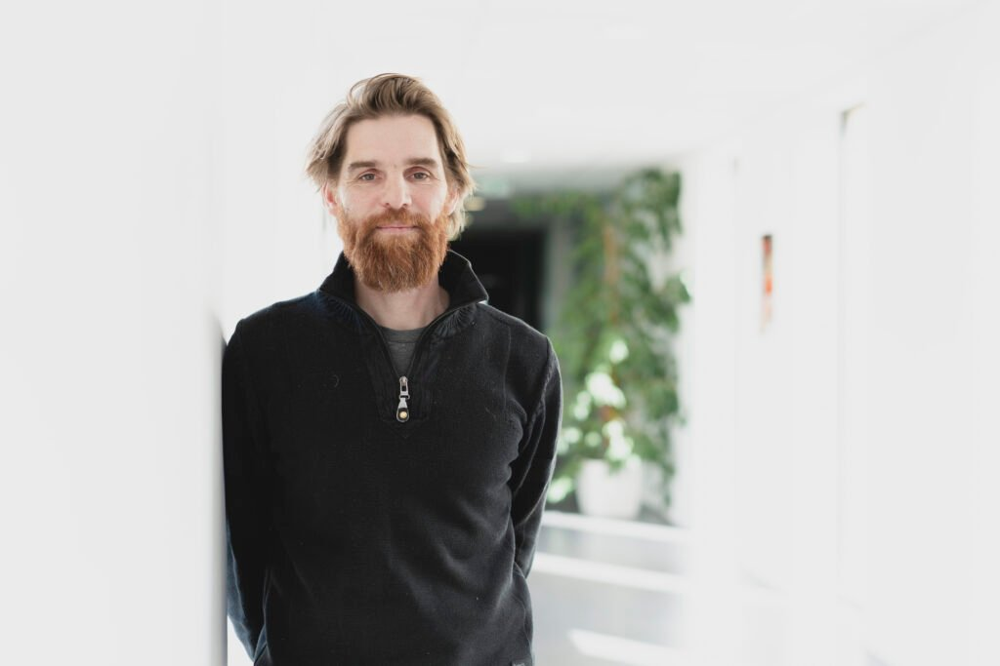
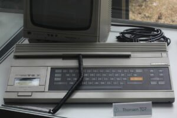
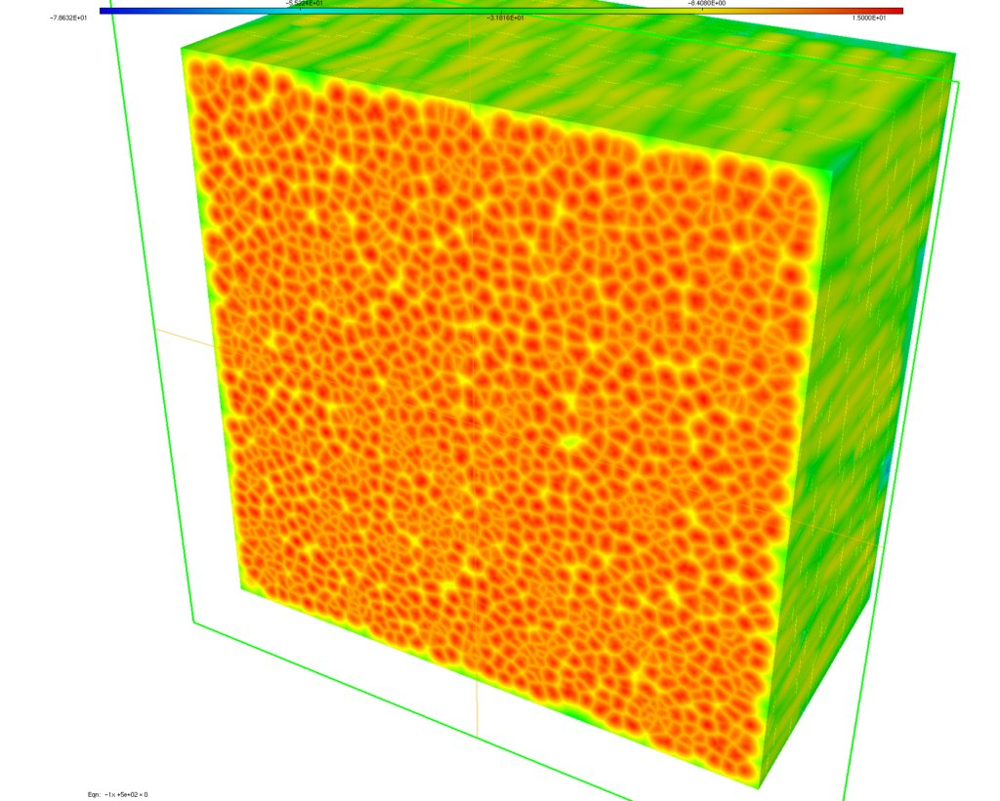
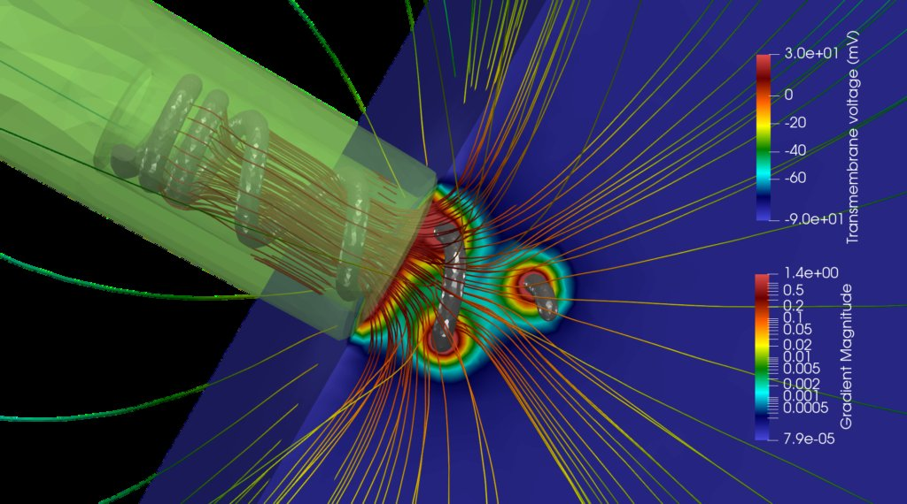

<figure class="article-figure">
  
  <figcaption>© Yves Coudière</figcaption>
</figure>

Yves Coudière est enseignant-chercheur et responsable de l’équipe-projet Carmen au centre Inria de l’université de Bordeaux. Arrivé à l’Institut hospitalo-universitaire Liryc dès sa création en 2011, il travaille sur le projet MICROCARD, qui a pour but de modéliser le rythme cardiaque. D’ici à la fin de l’année 2024, des résultats prometteurs sont attendus.

Après un premier échange avec Yves Coudière lors de notre émission sur radio Campus, « [Sciences à l’antenne](https://soundcloud.com/radiocampusbx/sciences-a-lantenne-emission-nuit-des-chercheurs-2023) », dans le cadre de la Nuit Européenne des Chercheurs à Cap Sciences à la rentrée 2023, nous avons souhaité continuer la discussion. En effet son analogie entre la Ola dans les stades et la contraction des cellules cardiaques nous a étonnamment surpris et émerveillés. Il nous reçoit à l’Institut des maladies du rythme cardiaque (Liryc), à l’étage d’un bâtiment neuf et nous propose d’échanger dans une pièce calme dotée d’une baie vitrée qui donne sur la forêt en contre-bas.

## Thomson TO7, l'ordinateur familial

<figure class="article-figure article-figure--right">
  
  <figcaption>Thomson TO7. Photograph by <a href="https://commons.wikimedia.org/wiki/User:Rama">Rama</a>, Wikimedia Commons, CC-BY-SA-2.0-FR</figcaption>
</figure>

Nous commençons par une question rituelle : pourquoi et comment est-il devenu scientifique ? Quand il nous demande jusqu’où nous devrions remonter, nous lui répondons qu’il n’a qu’à faire comme dans toute bonne histoire : nous raconter l’anecdote du jour de « la révélation ». « Ce n’est pas que j’ai découvert ma voie, mais effectivement j’ai toujours aimé les maths. » L’acquisition d’un ordinateur par ses parents à la fin des années 80, encore peu commun dans les foyers à cette époque, est un moment charnière. « Je pense que c’était le cas de beaucoup de gens de mon âge qui travaillent aujourd’hui dans le domaine informatique ou mathématique. L’ordinateur c’était un Thomson TO7, il marche encore. »

Pendant sa scolarité, il suit un parcours pour devenir ingénieur : études de mathématiques, classe préparatoire, école d’ingénieur. Mais avec toujours une idée derrière la tête : « Je savais que je ne voulais pas devenir ingénieur. Je voulais faire de la recherche académique ». Son diplôme d’ingénieur dans le domaine de l’aéronautique et du spatial en poche, il décide de se lancer dans une thèse qu’il soutient en 1999 à Toulouse. Après sa thèse, il recherche un emploi dans le monde académique : « Ce n’est pas facile, il faut se battre, être tenace, patient et il faut sans doute avoir un peu de chance aussi. »

Il arrive à décrocher un post-doctorat à Nice et y rejoint le centre Inria de Sophia Antipolis (devenu le Centre Inria d’Université Côte d’Azur depuis 2021) dans un projet où collaborent plusieurs équipes sur la modélisation numérique du cœur. « Les personnes qui avaient de la bouteille dans la recherche savaient déjà que l’on pouvait transposer les connaissances en mathématiques et en informatique, utilisées pour la physique ou l’industrie aérospatiale, vers le domaine de la santé. C’est une vieille idée ! C’est ce qui m’a lancé dans le domaine, j’ai construit ma trajectoire là-dessus. »

<blockquote class="article-exergue">Ce qui m’intéresse surtout dans le projet MICROCARD, c’est de comprendre comment chacune des milliards de cellules de cette pompe cardiaque se synchronisent à chaque battement.</blockquote>

## Le Liryc : de 4 chercheurs à plus de 150 collaborateurs

Après son séjour à Nice, il rejoint Nantes au début des années 2000 où il devient maître de conférence dans un laboratoire de mathématiques, pendant une décennie. A cette période, il commence à travailler avec des biologistes et des médecins de l’institut du thorax et en parallèle, il continue à échanger et collaborer avec la communauté qu’il avait côtoyée pendant sa thèse. « Ils travaillent sur des sujets assez différents, plutôt dans le domaine de la physique, sur ce qu’on appelle les écoulements en milieux poreux, comme l’extraction du pétrole ou le stockage souterrain de déchets radioactifs. C’est un peu un grand écart mais il y a des choses en commun ». Le mathématicien se pose alors la question de continuer dans le domaine de la santé ou bien de se lancer dans le domaine de l’environnement, comme le stockage du CO2. « Finalement, c’est pile à ce moment-là que le Liryc se crée ! » Dans le cadre du programme d’investissements d’avenir mis en place par l’État français en 2011, les instituts hospitalo-universitaires (IHU) sont créés pour stimuler la recherche médicale et l’innovation. Le Liryc fait partie de la première vague de six IHU et se donne comme mission principale de prévenir et guérir les maladies du rythme cardiaque. Recruté par les médecins fondateurs du projet dès la conception de l’institut, en 2011, le chercheur décide de s’installer à Bordeaux. « À partir de là je me plonge à 100% dans le domaine de la modélisation cardiaque. J’ai appris énormément depuis. On était quatre ou cinq plus les médecins, maintenant on est plus de 150. Il y a beaucoup de chercheuses et de chercheurs qui ont été recruté·e·s sur ce projet. »

## 270 millions de morceaux de sucre

<figure class="article-figure">
  
  <figcaption>Simulation d’un millicube de cellules cardiaques. © Yves Coudière</figcaption>
</figure>

A l’institut, le chercheur fait partie du projet transversal européen MICROCARD, qui a pour mission principale de faire avancer la modélisation cardiaque. Les résultats de ces modélisations peuvent permettre de mieux comprendre le rythme cardiaque et donc ses dysfonctionnements. Avec cette facilité à imager et rendre accessible des sujets complexes, le mathématicien prend le temps de nous expliquer comment il s’y prend, cette fois-ci avec du sucre et du café.

« Le cœur c’est une pompe balaise, robuste, longue durée. Je ne suis pas médecin, je suis mathématicien, ce qui m’intéresse surtout dans le projet MICROCARD, c’est de comprendre comment chacune des milliards de cellules de cette pompe cardiaque se synchronisent à chaque battement, se contractent au bon moment pour pouvoir envoyer du sang dans l’organisme. C’est possible grâce à des phénomènes électriques, mais malgré tout ce n’est pas facile à décrire. Mon travail est donc de mettre en équation ce système et d’utiliser un ordinateur pour résoudre ces équations, pour simuler cette synchronisation. »

Pour comprendre le mécanisme du rythme cardiaque, Yves Coudière nous précise que soit on s’intéresse à un tout petit morceau de tissu, de l’ordre d’un millimètre cube par exemple, soit on s’intéresse à l’organe en entier. Des équations mathématiques différentes seront utilisées pour chacune de ces échelles. Par exemple, « si on met un morceau de sucre dans du café, le café va monter progressivement dans la tasse. Il s’infiltre dans l’espace de chaque grain de sucre. On a donc 2 manières de mettre en équation : soit on met tout en équation, chaque grain de sucre et leur organisation dans l’espace. Soit on regarde d’un peu plus loin, en moyenne, et là on voit juste du café qui monte. C’est pareil pour le cœur, soit on regarde les cellules une par une et on regarde comment le potentiel électrique se propage d’une cellule à l’autre, soit on regarde une moyenne d’un peu plus loin et là on ne voit plus les cellules, on voit l’organe entier, comme un morceau de sucre ».

<figure class="article-figure">
  
  <figcaption>Simulation de lignes du champ électrique pendant le fonctionnement d’un pacemaker. © Yves Coudière</figcaption>
</figure>

Dans ce projet, Yves Coudière s’intéresse à la petite échelle. Il nous explique le concept d’homogénéisation en mathématiques, qui consiste à rendre un système complexe et hétérogène (comme le cœur) plus simple et homogène à une échelle différente. Cette approche permet de relier les équations des petites échelles (comme les cellules individuelles du cœur ou les grains d’un morceau de sucre) aux grandes échelles (comme le fonctionnement global du cœur ou le comportement du morceau de sucre dans le café). Mais plus l’échelle est petite, plus on s’approche du grain de sucre ou de la cellule cardiaque, plus la compréhension du fonctionnement est précise. Mais plus les morceaux sont petits, plus le nombre de calculs nécessaires augmente, atteignant rapidement des valeurs gigantesques.

Le projet MICROCARD est coordonné par le chercheur Mark Potse, chercheur à l’Institut de mathématiques de Bordeaux (IMB – CNRS, université de Bordeaux, Bordeaux INP), membre du Liryc et de l’équipe-projet Carmen du centre Inria de l’université de Bordeaux. Il vise à produire un logiciel capable de simuler le cœur à une échelle très fine, plus petite que celle des cellules cardiaques. Yves Coudière nous précise : « on a un millimètre cube de cœur dans lequel on a à peu près 7000 cellules cardiaques. Pour comprendre la géométrie de ces cellules, on a divisé ce millimètre non pas en cubes mais en tétraèdres (une pyramide à base triangulaire). On en a 270 millions et on espère réussir à en faire un calcul avant la fin de l’année ». On croise les doigts !

En plus de ses travaux de chercheur, Yves Coudière est très actif en médiation scientifique. Il a par exemple participé au projet « Heart Attack », un jeu intégré dans un site internet où le joueur prend le rôle d’un ingénieur et peut appréhender et manipuler le fonctionnement électrique du cœur par le biais de la modélisation et de la simulation grâce à une interface interactive. Il participe aussi régulièrement à différentes animations de la Fête de la science et de la Nuit européenne des chercheur·e·s.

**Pour aller plus loin :**
- [Sciences à l’antenne](https://soundcloud.com/radiocampusbx/sciences-a-lantenne-emission-nuit-des-chercheurs-2023)
- [Inria – Nuit européenne des chercheur·e·s](https://www.inria.fr/fr/nuit-europeenne-chercheures-2022-bordeaux)
- [Inria – Fête de la science](https://www.inria.fr/fr/fete-science-2021-bordeaux-decouverte-sciences-numerique)

Julien Campet

