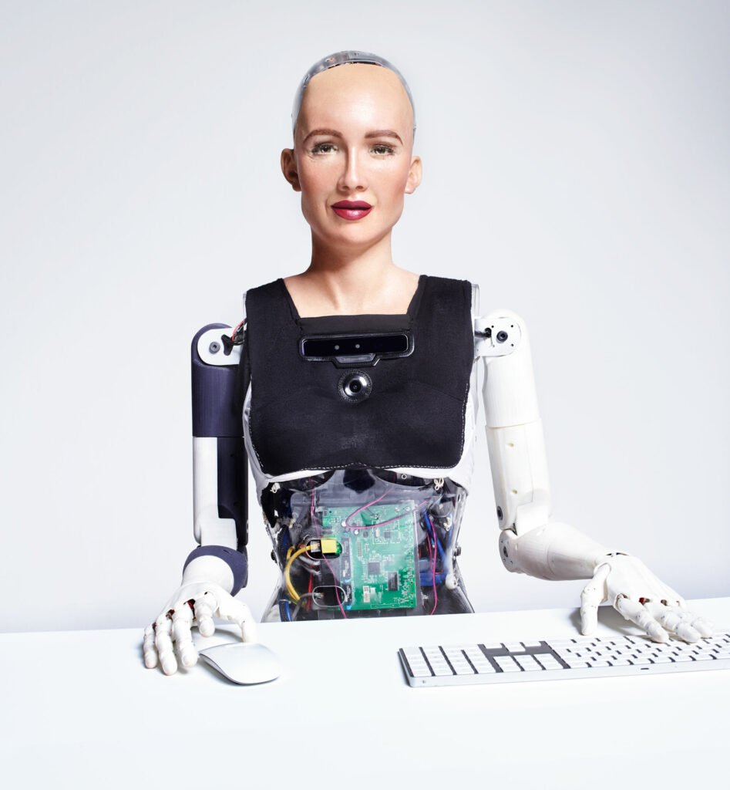
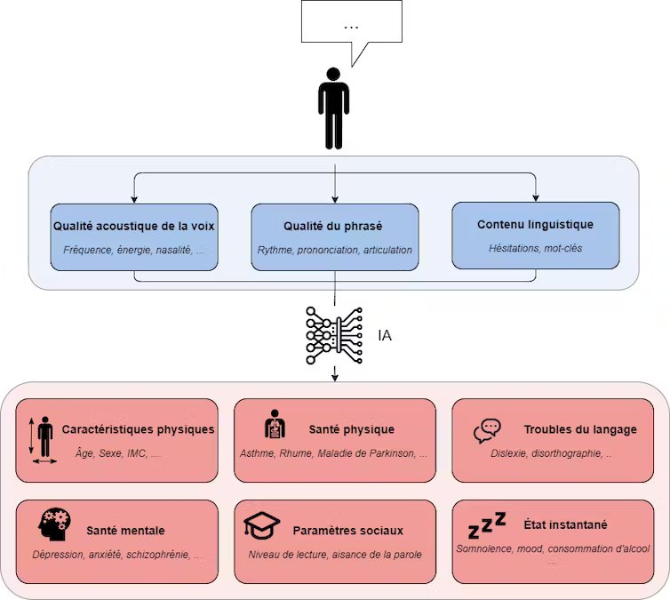
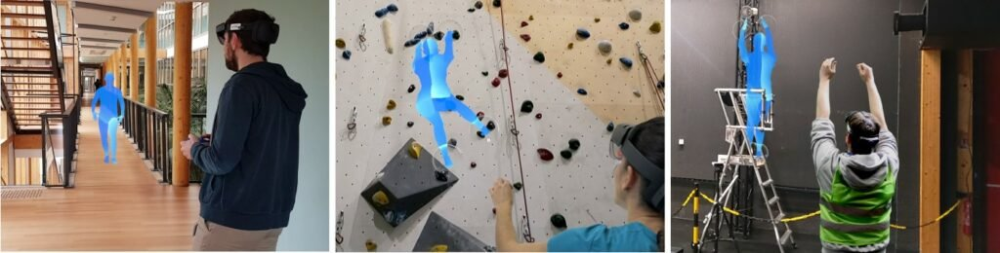

Soigner les corps

La « Vallée de l’étrange », une théorie inventée par le roboticien Masahiro Mori dans les années 1970, désigne le fait que plus un objet nous ressemble plus nous ressentons une sensation d’angoisse et de malaise. Il suffit de regarder Sophia, un robot humanoïde « activé » le 19 avril 2015 par Hanson Robotics, pour ressentir cet effet. Mais avec l’évolution de nos comportements liée aux avancées scientifiques et technologiques, ce n’est plus seulement une reproduction à l’image de l’espèce humaine qui est à l’œuvre, mais bien notre propre copie numérique.

La notion de jumeau numérique, qui représente le modèle virtuel d’un objet physique, d’un système ou d’un processus du monde réel, a gagné en popularité dans les années 2010 et s’est développée dans des secteurs industriels tel que l’aérospatial. La copie numérique peut ainsi récupérer différentes données depuis l’objet physique, comme la météo sur un avion et simuler des problèmes, détecter des anomalies, prédire des pannes ou encore proposer des améliorations.

Même si nous sommes encore loin de comprendre la complexité des processus biologiques et donc d’en faire des reproductions parfaites, ce concept de jumeau numérique est peu à peu adapté à nos propres corps, dans le domaine de la santé numérique et de la médecine personnalisée notamment.

<figure class="article-figure article-figure--narrow">
  
  <figcaption>© Hanson Robotics</figcaption>
</figure>

## Mon double vocal : comment ma voix révèle ma santé

En enregistrant notre voix sur notre téléphone par exemple, des scientifiques sont capables de détecter divers états de notre santé, comme des signes de troubles neurologiques. Docteur en informatique de l’université de Bordeaux, Vincent Martin a travaillé sur ces biomarqueurs vocaux pour la détection de la somnolence et de troubles psychiatriques au sein du LaBRI et de l’unité SANPSY. Aujourd’hui au Luxembourg Institute of Health, il s’intéresse aux biomarqueurs vocaux pour améliorer la prise en charge de la santé mentale chez les personnes atteintes du cancer du sein. Comment la voix peut-elle révéler autant de choses sur notre santé ? Une fois l’enregistrement effectué, plusieurs marqueurs sont extraits de notre voix, telle que la qualité acoustique (comme la nasalité ou l’amplitude), la qualité du phrasé (comme la prononciation) ou encore le contenu linguistique. Toutes ces informations sont calculées et interprétées par des algorithmes d’intelligence artificielle supervisés les ingénieurs et scientifiques compétents.

## Donnez-moi mes données que je puisse mieux courir, dormir et manger

Si ces outils numériques permettent d’évoluer vers une médecine de plus en plus personnalisée et donc a priori plus efficace, ils peuvent aussi faire évoluer la perception de notre propre corps. On ne compte plus le nombre d’applications d’automesure sur nos smartphones et nos montres connectées. Pour Vincent Martin, « l’idée, c’est d’améliorer son sommeil, d’améliorer ses performances sportives, etc. Ça a des effets bénéfiques, mais ça peut aussi avoir des effets néfastes ». Pour illustrer ces effets, il donne un exemple en médecine du sommeil : « ce n’est pas tant l’objet connecté en lui-même qui peut avoir un effet bénéfique, mais le fait que la personne porte l’objet. » Certain·e·s patient·e·s peuvent mieux dormir en étant plus conscient·e·s de leurs habitudes, tandis que d’autres peuvent ressentir de l’anxiété liée aux mauvais résultats de sommeil fournis par les dispositifs de mesure, ce qui peut aggraver leur situation. La mesure en elle-même ne sert à rien si elle n’est pas mise en contexte avec celui ou celle qui la mesure : c’est ce qu’on appelle l’objectivité située.

<figure class="article-figure article-figure--narrow">
  
  <figcaption>© Vincent Martin</figcaption>
</figure>

## Comment je suis devenu·e meilleur·e à l’escalade grâce à mon double virtuel

Au-delà de la reproduction virtuelle de certains de nos organes ou de leur fonctionnement pour en extraire des données, l’incarnation d’un double numérique offre des possibilités fascinantes. Par exemple, l’équipe-projet Potioc, commune entre Inria, université de Bordeaux et CNRS, explore cette possibilité : grâce à des casques de réalité augmentée, les scientifiques ont conçu des avatars virtuels basés sur certains aspects de la silhouette de l’utilisateur·ice et pouvant être contrôlés à distance dans l’environnement réel, comme un mur d’escalade. L’une des études a montré que l’utilisateur·ice avait gagné en précision et en confiance dans sa capacité d’agir dans le monde réel. Comment ? Il·elle aurait tendance à s’approprier les attributs de l’avatar virtuel, comme s’il·elle incarnait son double virtuel, ce qui a pour effet de modifier sa propre perception de la réalité.

<figure class="article-figure">
  
  <figcaption>© Potioc Inria</figcaption>
</figure>

## Des outils technologiques au service de la relation de soin

Ces technologies qui touchent à nos corps soulèvent de nombreuses questions éthiques. Elles ont déjà un impact réel, à l’image de la grève historique qui a opposé les acteur·ice·s du syndicat SAG-AFTRA aux studios hollywoodiens qui souhaitaient pouvoir scanner les figurant·e·s et les répliquer virtuellement à l’infini dans leurs futures productions.

Mais elles semblent aussi prometteuses pour améliorer les soins et éprouver des théories encore impossibles à tester il y a quelques années encore.

Les scientifiques de l’équipe Potioc continuent d’explorer la réalité augmentée à travers d’autres expérimentations tel que Welfare, qui pourrait permettre à des étudiant·e·s dans les domaines de la santé de faire l’expérience des troubles de la schizophrénie, dans le but de mieux comprendre les symptômes. Quant aux recherches de Vincent Martin, il reste encore un long chemin à parcourir avant que ces outils soient véritablement utiles pour les patient·e·s, les médecins et les agences de régulation de la santé : « j’essaie de chercher tous les critères de tous les acteur·ice·s impliqué·e·s pour que les biomarqueurs vocaux puissent être utiles au suivi de la santé mentale dans les maladies chroniques. Plus qu’un défi technologique, mes recherches interrogent aussi les relations entre médecins et patient·e·s. »

Julien Campet

